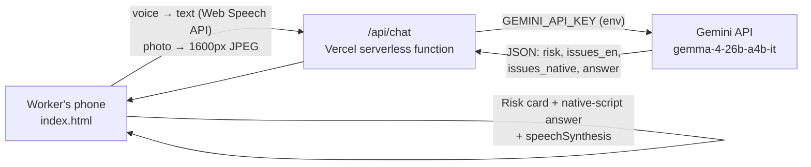

# Haqq (حق · हक़) - Know your rights, in your language

**Haqq** is a voice-first web app for migrant workers in the UAE. A worker speaks a question or snaps a photo of a contract, payslip or notice. **Gemma 4** reads it and explains it **aloud** in **20 languages**, including Hindi, Urdu, Malayalam, Tagalog, Arabic, Bengali, Nepali, Tamil and more. A red / amber / green **Risk Check** card flags terms that break UAE labour rules and points the worker to the **MOHRE helpline (600590000)**.

> ⚠️ **Not legal advice.** Haqq gives simple, general information. For your case, contact MOHRE on **600590000**.

## Why

Millions of workers in the UAE sign contracts and receive payslips in a language they can't read. Haqq turns a confusing document into a short, spoken explanation in the worker's own language, and flags red-flag terms such as a kept passport, unpaid overtime or illegal recruitment fees.

## Features

- 🎤 **Voice in, voice out**: Web Speech API mic input with a live transcript of what Haqq heard; answers spoken with the device's text-to-speech.
- 💬 **Voice chat mode**: hands-free conversation. After each spoken answer Haqq listens again, and the last 4 turns go to Gemma as context, so follow-ups like "so what should I do?" work. A conversation log and a New chat button sit above the answer.
- 🗣️ **20 languages**: Hindi, Urdu, Malayalam, Tagalog, Arabic, English, Bengali, Nepali, Tamil, Telugu, Sinhala, Punjabi, Pashto, Amharic, Swahili, Indonesian, Kannada, Marathi, Gujarati and Persian. Six are one tap away; the rest are under "More". UI translations for the newer languages are best-effort and would benefit from native-speaker review. Voice input and output depend on what each browser and device supports.
- 📷 **Scan a document**: photo is downscaled to 1600px JPEG in the browser and sent to Gemma 4 as an image.
- 🚦 **Risk Check card**: red / amber / green, with an issue count and each issue shown in the worker's language **and** in English.
- 🌍 **Real multilingual UX**: native-script answers (never romanized), automatic right-to-left layout for Urdu, Arabic, Pashto and Persian, and a Noto font for every script (Devanagari, Nastaliq, Naskh, Malayalam, Bengali, Tamil, Telugu, Sinhala, Gurmukhi, Ethiopic, Kannada, Gujarati).
- 📤 **Share with family**: Web Share API (falls back to copy to clipboard) with the answer plus the MOHRE number.
- 🧪 **Two built-in samples**: a contract and a payslip with planted violations, for an instant demo.
- 📄 **PDF support**: PDFs are rendered to page images in the browser (first 3 pages) and read like photos.
- 📥 **Downloadable test documents** on the page and in [`/samples`](samples): an unfair offer letter (expect red) and a fair salary slip (expect green), as PDF and PNG. They are fictional.
- 🛡️ **Demo-proof**: automatic retries when Gemma is busy or slow, one retry on malformed JSON, a re-ask if the reply is in the wrong script, a raw-text fallback, and a friendly error card with a retry button.
- 📱 **Show QR** so anyone in the room can open the app on their phone.
- 🔒 API key stays server-side (Vercel env var). No database, no accounts, nothing stored.

## Grounded rules (no invented laws)

The prompt only allows Gemma to use these rules, and to say "not sure, call MOHRE" otherwise:

1. No passport retention by the employer.
2. Max 8 hours/day or 48 hours/week; overtime must be paid.
3. At least 1 paid rest day per week.
4. Salary at least monthly, through WPS.
5. End-of-service gratuity after 1 year.
6. No recruitment, visa or resignation fees charged to the worker.

## Architecture



- `index.html`: a single-file vanilla HTML/CSS/JS frontend. No framework, no build step.
- `api/chat.js`: a serverless proxy to `generativelanguage.googleapis.com/v1beta/models/{model}:generateContent`. It allow-lists `gemma-4-26b-a4b-it` (default) and `gemma-4-31b-it`. `GET /api/chat` is a health check.
- Gemma returns `{"risk":"red|amber|green|none","issues_en":[...],"issues_native":[...],"answer":"..."}`. The client strips code fences, drops `thought` parts, validates the result, retries once with "Return valid JSON only", and then falls back to plain text.

## Run locally

```bash
# Option A: full stack (uses GEMINI_API_KEY from your environment / .env)
npm i -g vercel
vercel dev

# Option B: static only. Open Settings in the app and paste a Gemini API key
# (stored in your browser only; calls the Gemini API directly)
npx serve .
```

Get a key at <https://aistudio.google.com/apikey>.

## Deploy to Vercel

1. Push this repo to GitHub (public).
2. On vercel.com, go to **Add New → Project** and import the repo. Framework preset: **Other**. No build command.
3. Under **Settings → Environment Variables**, add `GEMINI_API_KEY` for Production (and Preview), then redeploy.
4. Check `https://<your-app>.vercel.app/api/chat`. It should show `{"ok":true,"hasKey":true,...}`.

## Hackathon tracks entered

Hacktoberfest Hack Day Dubai x Legesher (MLH):

- **Best Open-Source AI Project**: public repo, MIT license.
- **Best Use of Gemma 4**: Gemma 4 does the multimodal reading (document photos), multilingual reasoning and structured JSON output, all through the Gemini API.
- **Best Innovation in Your Language**: native-script spoken answers in Hindi, Urdu, Malayalam, Tagalog and Arabic, with RTL and proper fonts.

## Challenges

- Getting **reliable JSON** out of an open model: we added a strict schema prompt, fence stripping, validation, one retry and a plain-text fallback.
- **Script and direction**: Urdu Nastaliq needs extra line height, and Urdu and Arabic need RTL.
- **TTS coverage varies by device**: many phones lack an Urdu or Malayalam voice, so Haqq says so and shows the text instead of failing silently.
- Keeping the answer **grounded**: a fixed list of rules, with "call MOHRE" for everything else.

## License

[MIT](LICENSE) © 2026 the Haqq team.

## Disclaimer

Haqq provides general information only and is **not legal advice**. Laws change and every case is different. Contact the UAE Ministry of Human Resources and Emiratisation (**MOHRE**) on **600590000** for official help.
